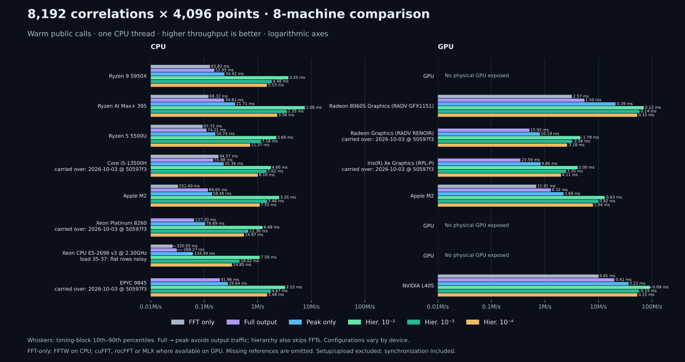
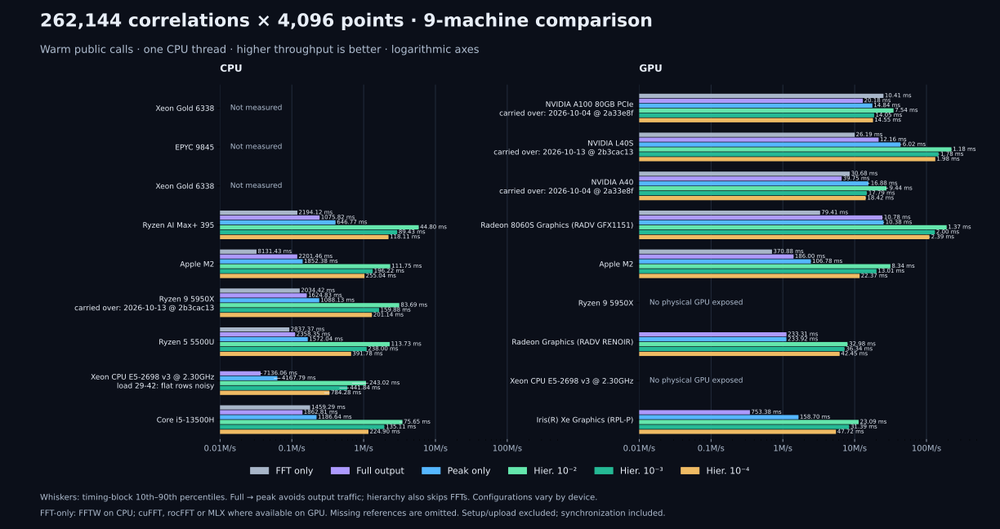

# Hardware comparison at revision 2b3cac13

Measured October 13, 2026 (UTC), at library revision `2b3cac13`, the
`main` head prepared for the 0.1.0a7 alpha. This recalculates
[the October 3 comparison](teaser-fleet-20261003.md); earlier pages are kept
for history. Every timing block is in the recorded JSON.

Not every machine was re-measured. Entries marked **†** are carried over
unchanged from the earlier JSON, with their original date and revision, and
are labelled as such in the figures and on the interactive page:

- 16 × 512: the Radeon integrated GPU of the Ryzen 5 5500U (gravity-dev3),
  the Core i5-13500H CPU and Iris Xe GPU (gravity-dev4), the Xeon Platinum
  8260 VM (sugwg-login2) and the EPYC 9845 CPU of the L40S node
  (sugwg-l40s), all from October 3 at `50597f3`.
- 512 × 512: the NVIDIA A100 80GB and A40, from the
  [512 × 512 JSON of October 3](gpu-fleet-512x512-20261003.json), whose
  reports were recorded on October 4 at `2a33e8f`.

Entries marked **‡** are the Haswell node, a shared cluster node that ran at
load 35–37 throughout. Its timing blocks spread by up to 1.36× (16 × 512) and
1.68× (512 × 512) within one mode, and its SNR sweep is not monotone at 16 ×
512, so its rows are indicative only.



[Machine-readable results, 16 × 512](teaser-fleet-20261013.json) and
[512 × 512](gpu-fleet-512x512-20261013.json) include hardware, backend,
software versions, CPU affinity, load averages, correctness checks, every
timing block, the gate chain each hierarchical row selected, and refinement
fractions. Bars show median throughput; whiskers show the timing-block
10th–90th percentiles, not statistical confidence intervals.

## Workload and timing

Each call processes **16 or 512 data spectra × 512 templates × 4096 points**
with Gaussian noise and a full lag window, with the bank drawn from the
captured PyCBC reference profile (`tests/data/reference_profile_pycbc.npy`).
Hierarchical rows are recorded at SNR thresholds 5.0, 5.5, 5.75, 6.0 and
6.5; the static charts and the main tables show 5.5. These are warm public
`run()` calls, not `run_series()` or isolated kernel times. CPU calls use
one thread; Linux processes are pinned to one CPU (gravity-dev2 uses CPU 2,
Haswell CPU 50); macOS schedules its thread. Setup, calibration, template
preparation and input upload are excluded. Full correlation reuses output
storage; GPU calls include synchronization. All reports come from
`tools/teaser_fleet.py`.

## Environment

16 × 512:

| Host | Device | Measured (UTC) | Revision | Load before → after | Notes |
|---|---|---|---|---|---|
| gravity-dev1 | CPU | 2026-10-13 22:50 | `2b3cac13` | 0.1 → 1.1 |  |
| gravity-dev2 | CPU | 2026-10-13 22:57 | `2b3cac13` | 0.8 → 1.5 |  |
| gravity-dev2 | GPU | 2026-10-13 22:45 | `2b3cac13` | 1.5 → 1.3 |  |
| gravity-dev3 | CPU | 2026-10-13 22:50 | `2b3cac13` | 0.4 → 1.0 | native library built on gravity-dev2 at the same revision (dev2-built .so) |
| gravity-dev3 | GPU | 2026-10-03 17:06 | `50597f3` | 0.5 → 0.6 | carried over from `teaser-fleet-20261003.json`, not re-measured |
| gravity-dev4 | CPU | 2026-10-03 17:06 | `50597f3` | 0.0 → 0.5 | carried over from `teaser-fleet-20261003.json`, not re-measured |
| gravity-dev4 | GPU | 2026-10-03 17:06 | `50597f3` | 0.5 → 0.4 | carried over from `teaser-fleet-20261003.json`, not re-measured |
| empire-m2 | CPU | 2026-10-13 22:54 | `2b3cac13` | 2.1 → 1.9 |  |
| empire-m2 | GPU | 2026-10-13 22:47 | `2b3cac13` | 2.3 → 2.3 |  |
| sugwg-login2 | CPU | 2026-10-03 17:06 | `50597f3` | 1.5 → 1.8 | carried over from `teaser-fleet-20261003.json`, not re-measured |
| haswell | CPU | 2026-10-13 22:51 | `2b3cac13` | 35.4 → 36.1 | shared cluster node at load 35-37; full-output and peak-only rows are noisy |
| sugwg-l40s | CPU | 2026-10-03 21:16 | `50597f3` | 12.8 → 10.6 | carried over from `teaser-fleet-20261003.json`, not re-measured |
| sugwg-l40s | GPU | 2026-10-13 23:06 | `2b3cac13` | 2.3 → 1.8 | device_ms is 0.0 in this report: the CUDA device timer did not record; use the wall-clock ms |

512 × 512:

| Host | Device | Measured (UTC) | Revision | Load before → after | Notes |
|---|---|---|---|---|---|
| og-a100 | GPU | 2026-10-04 18:51 | `2a33e8f` | 2.4 → 3.1 | carried over from `gpu-fleet-512x512-20261003.json`, not re-measured |
| sugwg-l40s | GPU | 2026-10-13 23:03 | `2b3cac13` | 1.6 → 2.3 | device_ms is 0.0 in this report: the CUDA device timer did not record; use the wall-clock ms |
| og-a40 | GPU | 2026-10-04 18:50 | `2a33e8f` | 18.1 → 18.7 | carried over from `gpu-fleet-512x512-20261003.json`, not re-measured |
| gravity-dev2 | CPU | 2026-10-13 22:59 | `2b3cac13` | 1.5 → 2.0 |  |
| gravity-dev2 | GPU | 2026-10-13 22:43 | `2b3cac13` | 1.9 → 1.5 |  |
| empire-m2 | CPU | 2026-10-13 22:48 | `2b3cac13` | 2.3 → 2.1 |  |
| empire-m2 | GPU | 2026-10-13 22:45 | `2b3cac13` | 2.2 → 2.3 |  |
| gravity-dev1 | CPU | 2026-10-13 22:52 | `2b3cac13` | 1.1 → 1.3 |  |
| gravity-dev3 | CPU | 2026-10-13 22:53 | `2b3cac13` | 1.0 → 1.0 | native library built on gravity-dev2 at the same revision (dev2-built .so) |
| haswell | CPU | 2026-10-13 22:56 | `2b3cac13` | 37.5 → 34.2 | shared cluster node at load 35-37; full-output and peak-only rows are noisy |

Hosts without a physical GPU (gravity-dev1, sugwg-login2, Haswell) have no GPU
rows; software rendering is excluded. The L40S reports record a CUDA device
time of 0.0 ms, so only their wall-clock times are used here.

## 16 data × 512 templates (8,192 pairs)

Milliseconds per batch; smaller is faster. Hierarchical columns are at SNR 5.5.

| CPU | FFT only | Full | Peak | Hier. 0.01 | Hier. 0.001 | Hier. 0.0001 |
|---|---:|---:|---:|---:|---:|---:|
| Ryzen 9 5950X (CPU) | 63.82 (FFTW) | 52.95 | 34.42 | 2.20 | 4.48 | 5.53 |
| Ryzen AI Max+ 395 (CPU) | 68.32 (FFTW) | 34.81 | 21.71 | 1.08 | 2.35 | 3.56 |
| Ryzen 5 5500U (CPU) | 87.72 (FFTW) | 74.21 | 50.74 | 3.69 | 7.16 | 11.37 |
| Core i5-13500H (CPU) † | 44.57 (FFTW) | 55.88 | 35.36 | 4.66 | 5.62 | 8.16 |
| Apple M2 (CPU) | 252.69 (FFTW) | 69.65 | 58.46 | 3.26 | 5.46 | 7.55 |
| Xeon Platinum 8260 (CPU) † | unavailable | 127.20 | 78.89 | 6.68 | 12.36 | 14.87 |
| Xeon CPU E5-2698 v3 @ 2.30GHz (CPU) ‡ | 320.55 (FFTW) | 268.27 | 134.49 | 7.56 | 18.02 | 24.85 |
| EPYC 9845 (CPU) † | unavailable | 41.96 | 29.64 | 2.52 | 4.67 | 5.48 |

| GPU | FFT only | Full | Peak | Hier. 0.01 | Hier. 0.001 | Hier. 0.0001 |
|---|---:|---:|---:|---:|---:|---:|
| Radeon 8060S (GPU) | 2.57 (rocFFT) | 1.50 | 0.39 | 0.12 | 0.14 | 0.15 |
| Radeon Graphics — Ryzen 5 5500U (GPU) † | unavailable | 15.92 | 10.19 | 1.79 | 2.58 | 3.18 |
| Iris Xe Graphics (GPU) † | unavailable | 23.59 | 9.86 | 2.00 | 3.30 | 4.11 |
| Apple M2 (GPU) | 11.91 (MLX) | 6.32 | 3.68 | 0.63 | 0.82 | 1.04 |
| NVIDIA L40S (GPU) | 0.81 (cuFFT) | 0.41 | 0.22 | 0.09 | 0.15 | 0.15 |

At `fd=1e-3`, varying the SNR threshold:

| CPU | 5.0 | 5.5 | 5.75 | 6.0 | 6.5 |
|---|---:|---:|---:|---:|---:|
| Ryzen 9 5950X (CPU) | 10.15 | 4.48 | 2.53 | 1.97 | 1.12 |
| Ryzen AI Max+ 395 (CPU) | 5.66 | 2.35 | 1.30 | 0.88 | 0.61 |
| Ryzen 5 5500U (CPU) | 16.53 | 7.16 | 4.32 | 3.09 | 1.79 |
| Core i5-13500H (CPU) † | 10.79 | 5.62 | 3.85 | 4.50 | 3.18 |
| Apple M2 (CPU) | 11.58 | 5.46 | 3.62 | 2.88 | 1.69 |
| Xeon Platinum 8260 (CPU) † | 22.35 | 12.36 | 10.12 | 6.62 | 4.76 |
| Xeon CPU E5-2698 v3 @ 2.30GHz (CPU) ‡ | 33.90 | 18.02 | 8.90 | 11.31 | 3.48 |
| EPYC 9845 (CPU) † | 7.59 | 4.67 | 3.13 | 2.34 | 1.56 |

| GPU | 5.0 | 5.5 | 5.75 | 6.0 | 6.5 |
|---|---:|---:|---:|---:|---:|
| Radeon 8060S (GPU) | 0.17 | 0.14 | 0.13 | 0.11 | 0.10 |
| Radeon Graphics — Ryzen 5 5500U (GPU) † | 4.13 | 2.58 | 2.49 | 1.66 | 1.90 |
| Iris Xe Graphics (GPU) † | 4.95 | 3.30 | 2.27 | 1.95 | 1.74 |
| Apple M2 (GPU) | 1.79 | 0.82 | 0.64 | 0.62 | 0.46 |
| NVIDIA L40S (GPU) | 0.17 | 0.15 | 0.14 | 0.09 | 0.09 |

## 512 data × 512 templates (262,144 pairs)



The CPU rows at this size are new on this page.

| CPU | FFT only | Full | Peak | Hier. 0.01 | Hier. 0.001 | Hier. 0.0001 |
|---|---:|---:|---:|---:|---:|---:|
| Ryzen AI Max+ 395 (CPU) | 2231.38 (FFTW) | 1119.53 | 726.77 | 46.86 | 89.12 | 119.33 |
| Apple M2 (CPU) | 8125.06 (FFTW) | 2221.52 | 1867.55 | 113.83 | 199.64 | 260.54 |
| Ryzen 9 5950X (CPU) | 2034.42 (FFTW) | 1624.83 | 1088.13 | 83.69 | 159.88 | 201.14 |
| Ryzen 5 5500U (CPU) | 2818.82 (FFTW) | 2346.56 | 1625.38 | 121.05 | 243.25 | 395.42 |
| Xeon CPU E5-2698 v3 @ 2.30GHz (CPU) ‡ | 8676.29 (FFTW) | 6553.96 | 3730.78 | 310.33 | 542.61 | 784.25 |

| GPU | FFT only | Full | Peak | Hier. 0.01 | Hier. 0.001 | Hier. 0.0001 |
|---|---:|---:|---:|---:|---:|---:|
| NVIDIA A100 80GB PCIe (GPU) † | 10.41 (cuFFT) | 20.18 | 14.84 | 7.54 | 14.05 | 14.55 |
| NVIDIA L40S (GPU) | 26.19 (cuFFT) | 12.16 | 6.02 | 1.18 | 1.78 | 1.98 |
| NVIDIA A40 (GPU) † | 30.68 (cuFFT) | 39.75 | 16.88 | 9.44 | 17.79 | 18.42 |
| Radeon 8060S (GPU) | 79.67 (rocFFT) | 11.12 | 10.97 | 1.40 | 2.15 | 2.60 |
| Apple M2 (GPU) | 368.91 (MLX) | 186.45 | 106.73 | 9.18 | 13.71 | 21.94 |

At `fd=1e-3`, varying the SNR threshold:

| CPU | 5.0 | 5.5 | 5.75 | 6.0 | 6.5 |
|---|---:|---:|---:|---:|---:|
| Ryzen AI Max+ 395 (CPU) | 190.92 | 89.12 | 56.15 | 36.40 | 25.56 |
| Apple M2 (CPU) | 421.68 | 199.64 | 128.76 | 96.42 | 60.69 |
| Ryzen 9 5950X (CPU) | 355.67 | 159.88 | 99.28 | 67.34 | 43.03 |
| Ryzen 5 5500U (CPU) | 579.02 | 243.25 | 142.15 | 97.16 | 60.91 |
| Xeon CPU E5-2698 v3 @ 2.30GHz (CPU) ‡ | 1214.19 | 542.61 | 309.12 | 255.08 | 142.07 |

| GPU | 5.0 | 5.5 | 5.75 | 6.0 | 6.5 |
|---|---:|---:|---:|---:|---:|
| NVIDIA A100 80GB PCIe (GPU) † | 15.73 | 14.05 | 7.99 | 7.50 | 7.21 |
| NVIDIA L40S (GPU) | 2.66 | 1.78 | 1.21 | 0.97 | 0.92 |
| NVIDIA A40 (GPU) † | 19.39 | 17.79 | 9.77 | 9.44 | 9.18 |
| Radeon 8060S (GPU) | 3.54 | 2.15 | 1.76 | 1.33 | 1.02 |
| Apple M2 (GPU) | 46.47 | 13.71 | 10.01 | 8.51 | 4.53 |

## Change since the previous measurement

Milliseconds per batch, previous → now, for the entries re-measured on both
dates (hierarchical columns at SNR 5.5). The 16 × 512 baseline is the
October 3 JSON (`50597f3`); the 512 × 512 baseline is the October 3 JSON's
reports, recorded October 4 at `2a33e8f`. Apple M2 was host `empire` on
the earlier page. The Haswell node was loaded on both dates (load 41 on
October 3), so its changes are not attributable to the library.

16 × 512:

| Hardware | Full | Peak | Hier. 0.01 | Hier. 0.001 | Hier. 0.0001 |
|---|---:|---:|---:|---:|---:|
| Ryzen 9 5950X (CPU) | 51.71 → 52.95 | 34.37 → 34.42 | 3.82 → 2.20 | 4.95 → 4.48 | 7.73 → 5.53 |
| Ryzen AI Max+ 395 (CPU) | 43.24 → 34.81 | 24.66 → 21.71 | 1.95 → 1.08 | 4.31 → 2.35 | 6.31 → 3.56 |
| Radeon 8060S (GPU) | 1.63 → 1.50 | 0.83 → 0.39 | 0.16 → 0.12 | 0.18 → 0.14 | 0.21 → 0.15 |
| Ryzen 5 5500U (CPU) | 75.71 → 74.21 | 51.67 → 50.74 | 6.14 → 3.69 | 8.66 → 7.16 | 14.33 → 11.37 |
| Apple M2 (CPU) | 68.74 → 69.65 | 57.78 → 58.46 | 6.19 → 3.26 | 8.14 → 5.46 | 12.64 → 7.55 |
| Apple M2 (GPU) | 6.32 → 6.32 | 3.93 → 3.68 | 1.26 → 0.63 | 2.63 → 0.82 | 3.78 → 1.04 |
| Xeon CPU E5-2698 v3 @ 2.30GHz (CPU) ‡ | 199.11 → 268.27 | 120.00 → 134.49 | 18.26 → 7.56 | 18.76 → 18.02 | 28.88 → 24.85 |
| NVIDIA L40S (GPU) | 0.43 → 0.41 | 0.97 → 0.22 | 0.27 → 0.09 | 0.31 → 0.15 | 0.35 → 0.15 |

512 × 512:

| Hardware | Full | Peak | Hier. 0.01 | Hier. 0.001 | Hier. 0.0001 |
|---|---:|---:|---:|---:|---:|
| NVIDIA L40S (GPU) | 13.05 → 12.16 | 6.70 → 6.02 | 3.39 → 1.18 | 5.82 → 1.78 | 6.02 → 1.98 |
| Radeon 8060S (GPU) | 16.14 → 11.12 | 16.29 → 10.97 | 3.52 → 1.40 | 3.12 → 2.15 | 4.68 → 2.60 |
| Apple M2 (GPU) | 186.57 → 186.45 | 115.36 → 106.73 | 17.14 → 9.18 | 21.81 → 13.71 | 23.08 → 21.94 |

## Reproducing the charts

```bash
python tools/teaser_fleet.py --compare docs/measurements/teaser-fleet-20261013.json \
                             --out docs/assets/teaser-fleet.svg
python tools/teaser_fleet.py --compare docs/measurements/gpu-fleet-512x512-20261013.json \
                             --out docs/assets/gpu-fleet-512x512.svg
```

The README figure is drawn from the gravity-dev2 512 × 512 reports without
re-measuring:

```bash
python tools/teaser_figure.py --from-fleet dev2_cpu_512.json dev2_gpu_512.json \
                              --out docs/assets/teaser.svg
```
